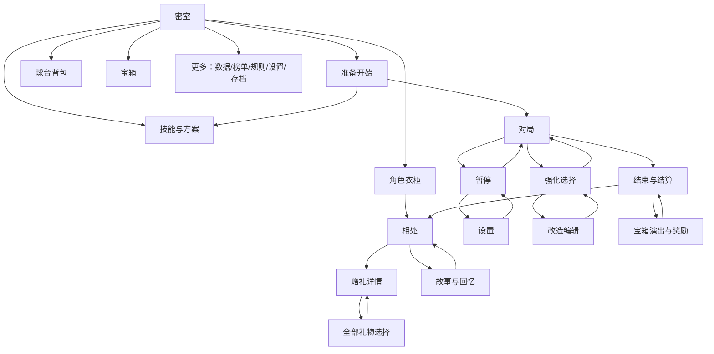

# 星陨弹珠案例

游戏实现与验证版本：v19.4.0，[提交 36f9231](https://github.com/momowangOUO/arcane-pinball/commit/36f9231df02db5af585d8806f9201ba5a60dae9d)。修复基线为 v19.3.1（a6f926412e4c21fe456b2d8af8c638c88e3184ff）。下列证据均固定到该提交。

本案例是手机优先、单文件 Canvas 游戏的特定选择，不规定所有游戏的风格、输入、列数和暂停行为。

| 区域 | 页面与操作 | 返回/状态要求 |
| --- | --- | --- |
| 首次进入/密室 | 昵称入口、场景物件、更多、方案、准备开始 | 密室为局外根；开始由实际方案进入对局 |
| 成长 | 技能页、节点详情、完整规则、球路设置 | 三方案、cost与容量；配置与本局生效区分 |
| 收藏 | 角色衣柜、球台背包、预览、购买、装备 | 保存角色/部位/选择；购买与穿戴分开 |
| 相处 | 角色、关系、赠礼、回忆、故事 | 保存来源、角色和页签；剧情进度与奖励独立 |
| 礼物 | 总览、筛选、单件详情、数量、兑换、赠送 | 选择不交易；奖励入口携带物品ID |
| 对局 | HUD、暂停、设置、强化、编辑、调整 | 暂停菜单与恢复分开；取消编辑回强化 |
| 结束 | 确认、结束演出、结算、宝箱入场/开箱、奖励 | 演出不发奖；深链返回来源结果 |
| 数据 | 总览、对局详情、排行榜/好友榜 | 返回使用真实来源，不用玩法阶段猜测 |
| 辅助 | 百科、语言、设置、存档导出/恢复 | 列表可浏览；恢复前预览确认；不误恢复对局 |

箭头表示主要路径，并非允许任意时候互相跳转。详细来源和恢复状态由实际进入路径决定。

## 经源码确认的基线问题

- 15种礼物拆为5页×3件，翻页会改变选中项；完整目录弹窗可减少反复翻页。
- 奖励进入赠礼页未传递选中礼物，浏览对象不一致。
- 暂停设置返回调用切换型pause函数，意外恢复对局。
- 百科仍讲最多3项装备，实际已按cost容量配置。
- 多页面默认返回密室，无法保留结算/衣柜进入来源。
- 子弹窗清理分散，增加新选择器时需要明确归属。

## 实施约束

保留原有插画与统一物品图标，三列手机/五列桌面是本项目选择。复用现有动态视口和本地交易；成长在本地，后端仅排行榜。完整规则可放详情，但主要效果、当前对象和操作后果不能藏起来。

原画、游戏运行包和玩家数据不包含在此技能许可中。截图应指向游戏仓库的版本化验证目录，不复制账号、存档或部署设置。

## 实际页面清单

| 界面 | 玩家任务与入口 | 主要操作／退出 | 保留状态与数据来源 | 滚动／暂停责任 |
| --- | --- | --- | --- | --- |
| 昵称登记 | 首次进入、存档页登记 | 确认昵称、语言；首次完成进入房间 | leaderboard 本机身份与注册结果 | 表单原有输入；不启动对局 |
| 魔女密室 | 启动、返回首页 | 开始、方案、技能、衣柜、球台背包、宝箱、相处、规则、设置、数据、排行 | meta 的资源、外观、方案、宝箱 | 原有房间适配与触摸逻辑 |
| 准备开始 | 房间开始按钮 | 查看方案、调整技能、开始／返回 | 已保存混搭方案、目录规则 | 原有预览；确认后才开始 |
| 技能树 | 房间技能、准备页调整 | 解锁、装备／卸下、三套方案、规则、球路、开始 | meta 研究、配装；mechanismCapacity 与 skillCost | 技能树自有滚动；异步完成不抢回离开的页面 |
| 球路设置 | 技能树／局内技能调整 | 预览、保存、返回 | 独立预览对象与草稿，确认才保存 | 既有编辑权限和对局阶段 |
| 游戏台面 | 确认开始 | 发射、挡板、震台、暂停、选卡／改造 | 冻结的 runContext、游戏状态 | 原有有效时间与输入系统 |
| 强化选择与卡片详情 | 升级 | 选卡、确认、重抽、查看详情、局内技能调整 | 当前真实候选、游戏可用次数 | 选择期间不计时；详情为原生子弹窗 |
| 台面改造、刻印与结束确认 | 选到改造／暂停结束 | 放置、取消、确认、选刻印、确认结束 | 独立编辑状态与既有回滚 | 原有输入隔离与确认控制器 |
| 暂停与画质设置 | 暂停按钮／暂停菜单 | 画质、动态效果、震动、继续、重开、结束 | beforePause 与本局状态 | 设置返回恢复暂停菜单；只有继续按钮恢复对局 |
| 结束演出与结算 | 失球／超时／手动结束 | 查看收益、关系、详情、排行榜、宝箱、再开 | 一次性结算回执与本局记录 | 沿用 endingPresentation／presentationInput |
| 宝箱收件箱、开启与进度说明 | 房间／结算 | 开箱、领取、查看进度、返回 | meta 宝箱与领取回执 | 原有 chestOpening 演出控制器；进度说明是子弹窗 |
| 角色衣柜 | 房间／关系页／物品链接 | 角色、衣装预览、兑换、穿戴、相处 | meta 外观与拥有状态；保留角色、衣装、筛选与滚动 | 衣柜各区原有滚动；关系返回恢复原衣柜 |
| 球台背包 | 房间／衣柜页签 | 部位、主题、拥有筛选、分页、预览、兑换／装备 | meta 收藏与外观；保留选择、页码、主题和部位 | 原有预览画布与物品列表 |
| 相处：相处／赠礼／回忆 | 房间角色、衣柜、结算、礼物链接 | 切角色／页签、交谈、赠礼、读故事、返回 | 当前角色、页签、礼物、进度与已确认回执 | 内容区滚动；返回真实进入来源 |
| 全部礼物弹窗 | 赠礼页 | 全部／已拥有、选择、关闭 | 15 件目录、inventory、giftValue；浏览无交易 | 网格独立滚动；原生焦点隔离与 Escape |
| 相处故事 | 相处／回忆 | 阅读、选择、继续、完成、回看、返回回忆 | 当前内容版本导出常量、保存游标／选择 | 原有故事分页；异步完成核对页面归属 |
| 数据总览 | 房间 | 日期筛选、分页、统计展开、打开对局 | ArcaneHistory；保留日期、页码和滚动 | 各统计与记录区域自有滚动 |
| 对局详情 | 总览／结算 | 概况、构筑、事件筛选、分页、导出、返回 | ArcaneHistory；返回实际来源视图 | 详情与事件列表自有滚动 |
| 排行榜、好友榜与管理表单 | 房间／结算／存档登记 | 全服／好友、建立、加入、关闭加入／退出确认、返回 | leaderboard 的 view 标识、身份与所选榜 | 原服务负责请求；离开使 view 失效，返回恢复调用页面 |
| 规则百科 | 房间 | 分类、搜索、展开、分页、返回 | 现行目录、机制节点、当前容量与消耗 | 规则内容自有滚动；删除旧三槽说明 |
| 设置、存档与设备 | 房间／暂停设置 | 画质、导出、恢复文件预览／确认、昵称 | 原有偏好与本机存档流程 | 暂停进入时保留暂停；导入按原确认流程 |
| 语言弹窗 | 首次登记／设置等 | 选择语言、关闭 | 原有 20 种语言结构和语言偏好 | 原生弹窗；关闭回到有效触发控件 |
| 横屏提示 | 触屏设备横屏 | 转回竖屏 | viewport-ui 的专用 portraitGuard | 专用方向锁，不纳入普通弹窗清理 |

## 阅读辨识修复

旧故事将旁白放在同一个带人物立绘的对话框中，容易读成角色说话。v19.4改为独立旁白区、具名对白框及框外玩家选项；按段落speaker判断，配角不借用主角立绘。320px下检查长叙述、选项和固定翻页按钮，颜色以外还有文本与结构区别。

## 图像比例问题与修复

故事头像原先分别设置百分比宽、高，裁剪计算假定容器宽高比为1.12。故事框变为0.65后，同一图像会纵向拉到约1.72倍。修复改用一个宽度缩放值与图像自然高度，视线位置单独平移；容器仍可裁剪，人物本身不再变形。这个问题说明需要核对实际绘制的图像，不能只看头像框是否合适。

审计同时检查了另外两种绘制路径：房间背景的100% 100%改为居中等比cover，按视口裁掉边缘；Canvas中的整幅球台图改为共享的等比cover裁剪。后者修复了水墨球台约1.22%的横向压缩，保持540×820逻辑台面与碰撞坐标不变。

[图像比例审计](https://github.com/momowangOUO/arcane-pinball/blob/36f9231df02db5af585d8806f9201ba5a60dae9d/docs/game-design/data/v194-image-ratio-audit.json)覆盖普通img、CSS背景与Canvas。Chrome155和WebKit26.5各检查193个页面状态，涵盖12套衣装与320×568、390×844、1280×900三种主要视口，房间另测320×844。每引擎采样1987处图像／背景，Canvas另记录312／244次绘制，并审查9处drawImage调用；未获例外的比例问题均为0。以上是桌面浏览器视口模拟，比较容差为0.5%，不代表手机真机验收或逐张人工审图。

保留了两个有设计理由的例外：房间方案物件上的三枚标签图标经过旋转与纵向压缩，以贴合插画斜面；低阶宝箱入场和封印崩解有短暂的挤压动画，宝箱最终恢复自然比例，封印则消失。这些例外只适用于对应物件和动画阶段，不能扩展到普通立绘、静态预览或整个奖励界面。
